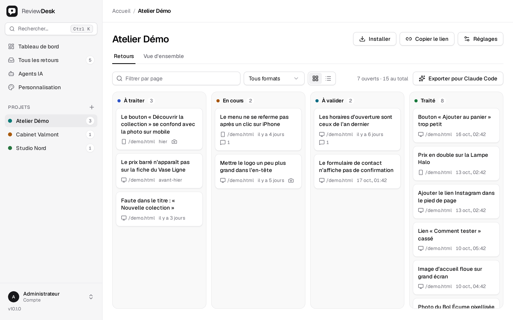
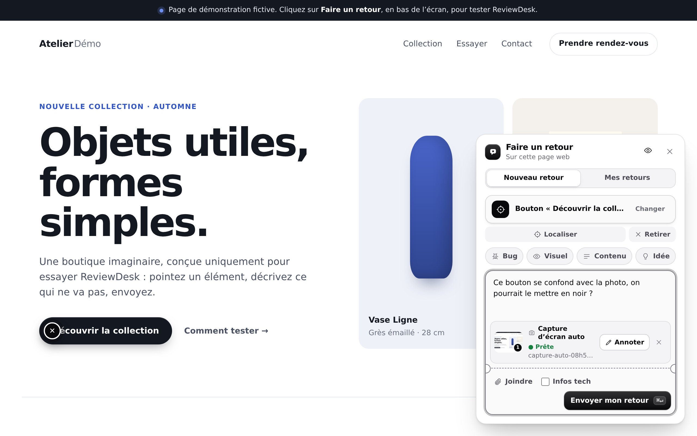
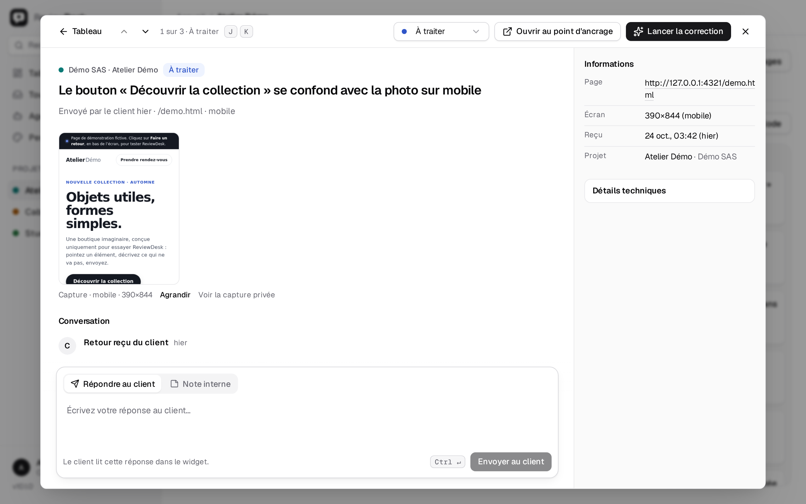

<div align="center">

<picture>
  <source media="(prefers-color-scheme: dark)" srcset="docs/assets/mark-dark.svg">
  
</picture>

# ReviewDesk

**Les retours de vos clients, épinglés à l’endroit exact de la page.**

Votre client clique sur ce qui ne va pas et écrit une phrase.
Vous recevez un ticket ancré à cet élément — sans compte à créer pour lui,
sans captures annotées par e-mail, sans deviner de quel bouton il parlait.

[](https://github.com/hugoinformatique/reviewdesk/releases/latest)
[](https://github.com/hugoinformatique/reviewdesk/actions/workflows/ci.yml)
[](LICENSE)
[](#démarrer)

[Démarrer](#démarrer) · [Fonctionnalités](#fonctionnalités) · [Ajouter à un site](#ajouter-le-widget-à-un-site) · [Agents IA](#brancher-un-agent-ia-mcp) · [Mises à jour](#mises-à-jour) · [English](README.md)

</div>

<br>

<picture>
  <source media="(prefers-color-scheme: dark)" srcset="docs/assets/screenshots/board-dark.png">
  
</picture>

## Pourquoi

Les retours sur un site de préproduction arrivent le plus souvent sous la forme de *« le bouton en bas a l’air bizarre »* —
dans un e-mail, sans URL, sans taille d’écran, avec une capture recadrée. Il faut alors deviner.

ReviewDesk supprime cette part de devinette. Un script d’une ligne ajoute un bouton **Faire un retour**
au site de préproduction. Le client désigne l’élément et écrit ce qui ne va pas ;
une capture d’écran l’accompagne. Le ticket conserve la page, l’élément, la
taille d’écran et un **lien de rejeu** qui rouvre la page avec l’épingle en place.

Il est gratuit, open source et **auto-hébergé** : les retours de vos clients restent sur votre serveur.

## Fonctionnalités

<table>
<tr>
<td width="50%" valign="top">

**Pour le client qui relit**

- Un bouton flottant, deux étapes : désigner l’endroit, dire ce qui ne va pas.
- Mise en évidence en direct de l’élément, nommé en langage clair — jamais un sélecteur CSS.
- Une capture de la page visible est prise au moment où il désigne l’élément — il peut l’annoter
  (dessin, flèche, floutage), la retirer, ou joindre / coller la sienne (`Ctrl/⌘ V`).
- *Bug · Visuel · Contenu · Idée* en un clic.
- Onglet **Mes retours** : le statut et les réponses de l’équipe, sur la page elle-même.
- Ni compte, ni mot de passe, ni extension.
- Shadow DOM : le CSS du site hôte ne peut pas le casser, et il ne casse rien.
- Reprend le thème clair/sombre de la **page hôte** ; utilisable au clavier et au tactile.

</td>
<td width="50%" valign="top">

**Pour l’équipe qui corrige**

- Plusieurs projets, chacun avec une liste exacte d’origines autorisées.
- Tableau (glisser-déposer) ou liste, filtres, palette de commandes `⌘K`.
- Statuts : *À traiter · En cours · À valider · Traité*.
- Un ticket est une conversation : répondre au client, ou laisser une note interne.
- **Lien de rejeu** : rouvre la page avec l’épingle sur l’élément.
- **Export en un prompt** : tous les tickets ouverts dans un seul bloc Markdown pour votre agent de code.
- **Serveur MCP + API agent** : Claude Code, Codex ou Cursor lisent, corrigent et clôturent les tickets.
- Vue d’ensemble : ce qui attend, ce qui a bougé sur 7/30/90 jours, par projet et par page.
- Webhook sortant, marque blanche, mode sombre.

</td>
</tr>
</table>

<table>
<tr>
<td width="50%" valign="top">

<p align="center"><sub><b>Côté client</b> — désigner, écrire, envoyer.</sub></p>
</td>
<td width="50%" valign="top">
<picture>
  <source media="(prefers-color-scheme: dark)" srcset="docs/assets/screenshots/ticket-dark.png">
  
</picture>
<p align="center"><sub><b>Côté équipe</b> — l’élément, la capture, la conversation.</sub></p>
</td>
</tr>
</table>

> [!NOTE]
> L’interface (administration et widget) est en **français**. Le libellé du bouton est
> réglable ; une interface anglaise complète serait une contribution bienvenue.

## Démarrer

| | Il vous faut | Idéal pour |
| --- | --- | --- |
| **[Docker Compose](#docker-compose-recommandé)** | Un serveur Linux avec Docker | L’utiliser pour de bon, sur votre propre infrastructure |
| **[Kit local](#lessayer-sur-votre-machine)** | Node.js 22 | L’essayer sur votre portable en deux minutes |
| **[Vercel](#vercel)** | PostgreSQL + un bucket S3 | Serverless, rien à maintenir |

### Docker Compose (recommandé)

Tout tourne sur un seul hôte : l’application, PostgreSQL 17 et un stockage S3
privé intégré pour les captures. Pas de Node.js sur l’hôte, pas de compte cloud.

1. Téléchargez `reviewdesk-vX.Y.Z-docker.zip` et son `.sha256` depuis la
   **[dernière release](https://github.com/hugoinformatique/reviewdesk/releases/latest)**.
2. Installez et démarrez :

   ```sh
   sha256sum -c reviewdesk-v*-docker.zip.sha256
   unzip reviewdesk-v*-docker.zip && cd reviewdesk-v*-docker
   sh install.sh --non-interactive --port 48300   # écrit .env, les secrets et le TLS interne
   docker compose up -d --build
   curl -fsS http://127.0.0.1:48300/health
   ```

3. Placez un reverse proxy HTTPS devant (exemples Caddy et nginx dans le guide)
   et ouvrez l’administration. Le mot de passe administrateur se trouve dans `secrets/admin_password`.

Le déroulé complet — HTTPS, S3 externe, sauvegardes, dépannage — se trouve dans le
**[guide Docker](docs/GUIDE-DOCKER-FR.md)** ([English](docs/GUIDE-DOCKER-EN.md)).

### L’essayer sur votre machine

Téléchargez `reviewdesk-vX.Y.Z-local.zip` depuis la
[dernière release](https://github.com/hugoinformatique/reviewdesk/releases/latest),
décompressez-le, puis :

```sh
node install.mjs   # demande le mot de passe administrateur
node start.mjs     # http://127.0.0.1:4300 — identifiant : admin
```

Fonctionne sous Windows, macOS et Linux avec Node.js 22 ; les données restent dans le dossier.
Pour une évaluation en local uniquement — voir le [guide du kit local](docs/KIT-LOCAL.md).

### Vercel

1. **Forkez** ce dépôt et importez-le dans Vercel.
2. Créez une base **PostgreSQL** dédiée (Neon, Supabase…) et un **bucket S3
   privé** (Cloudflare R2, AWS S3, Scaleway, Backblaze B2…).
3. Définissez les variables d’environnement, puis déployez :

   ```text
   ADMIN_PASSWORD=<long random passphrase>
   NODE_ENV=production
   DATABASE_URL=postgresql://…pooler…/reviewdesk?sslmode=require
   STORAGE_DRIVER=s3
   S3_ENDPOINT=https://<ACCOUNT_ID>.r2.cloudflarestorage.com
   S3_BUCKET=reviewdesk-uploads
   S3_REGION=auto
   S3_ACCESS_KEY_ID=…
   S3_SECRET_ACCESS_KEY=…
   S3_FORCE_PATH_STYLE=true
   ```

`vercel.json` construit les ressources statiques et achemine `/api/*` et `/health` vers la
fonction. Vérifiez `/health`, connectez-vous, créez un projet. Chaque variable est
documentée dans [`.env.example`](.env.example).

### Depuis les sources

```sh
git clone https://github.com/hugoinformatique/reviewdesk.git && cd reviewdesk
npm ci
npm run build
ADMIN_PASSWORD="a-long-random-passphrase" DATABASE_URL="pglite://.data/reviewdesk" \
  STORAGE_DRIVER=filesystem npm start          # http://127.0.0.1:4300
```

`npm run package:docker` et `npm run package:local` construisent les mêmes kits que les
releases, dans `dist/kits/`.

## Ajouter le widget à un site

Dans l’administration, créez un projet avec l’adresse du site. Elle vous donne une ligne,
déjà renseignée, à coller avant `</body>` :

```html
<script src="https://reviews.example.com/widget.js#project=PROJECT_ID&token=REVIEW_LINK_SECRET" defer></script>
```

Les réglages passent dans le fragment d’URL (`#…`), que les navigateurs n’envoient jamais à un
serveur : le secret n’apparaît pas dans les journaux d’accès.

| Outil | Où placer la ligne |
| --- | --- |
| **WordPress** | L’extension ReviewDesk, servie par votre instance à l’adresse `/integrations/reviewdesk-wordpress.zip` |
| **Webflow** | Site settings › Custom code › Footer code |
| **Framer** | Site Settings › General › Custom Code › End of `<body>` |
| **Wix** | Settings › Custom code › Body – end |
| **Squarespace** | Settings › Advanced › Code injection › Footer |
| **Google Tag Manager** | Custom HTML tag, All Pages trigger |
| **Rien à installer** | Un lien de relecture : le client glisse un favori *Faire un retour* (ordinateur uniquement) |

<details>
<summary><b>Options du widget et initialisation manuelle</b></summary>

<br>

Chaque réglage se place dans le fragment (`#project=…&label=…`), un attribut `data-*`
ou `init()` ; l’attribut l’emporte sur le fragment.

| Attribut | `init()` | Défaut | Effet |
| --- | --- | --- | --- |
| `data-api` | `api` | l’origine du script | Origine de l’API ReviewDesk. |
| `data-project` | `projectId` | — | UUID du projet. **Obligatoire.** |
| `data-token` | `token` | — | Secret du lien de relecture. **Obligatoire.** |
| `data-label` | `label` | `Faire un retour` | Libellé du bouton flottant. |
| `data-position` | `position` | `bottom-right` | `bottom-right` ou `bottom-left`. |
| `data-accent` | `accent` | `#4338ca` | Couleur d’accent, pour s’accorder au site. |

Pour React, Astro ou Next quand le jeton provient de l’état de l’application :

```html
<script src="https://reviews.example.com/widget.js"></script>
<script>
  ReviewDesk.init({ api: 'https://reviews.example.com', projectId: 'PROJECT_ID', token: 'REVIEW_LINK_SECRET' })
</script>
```

</details>

> [!IMPORTANT]
> N’ajoutez le script qu’à un **site de préproduction protégé**. Le jeton présent dans la page permet
> à quiconque voit la page de laisser un retour sur ce projet. Il peut être révoqué
> à tout moment depuis l’administration.

## Brancher un agent IA (MCP)

Un agent de code — Claude Code, Codex, Cursor, Claude Desktop, VS Code ou tout client
MCP — peut lire les retours, les corriger et rendre compte au client.

1. Administration › **Agents IA** › créez un jeton (un projet ou tous, lecture seule ou lecture/écriture).
   Le secret `rda_…` est affiché une seule fois, avec la configuration MCP déjà rédigée.
2. Enregistrez le serveur (construit par `npm run build` dans `dist/mcp.js`) :

   ```sh
   claude mcp add reviewdesk \
     --env REVIEWDESK_URL=https://reviews.example.com \
     --env REVIEWDESK_TOKEN=rda_… \
     -- node /path/to/reviewdesk/dist/mcp.js
   ```

3. Demandez : *« Passe en revue les tickets ReviewDesk à traiter du projet X, corrige-les, puis
   passe chacun à « À valider » avec une note sur ce que tu as modifié. »*

| Outil | Rôle |
| --- | --- |
| `list_projects` | Projets visibles par le jeton, avec le nombre de tickets par statut. |
| `list_tickets` | Tickets filtrés par statut, projet, page ou format. |
| `next_fix_request` | Le plus ancien ticket que l’équipe a confié à un agent avec **Lancer la correction**. |
| `get_ticket` | Élément, page, écran, diagnostics et historique. |
| `get_screenshot` | La capture d’écran du client, sous forme d’image. |
| `comment_ticket` | Un commentaire interne, ou une réponse publiée au client. |
| `update_ticket` | Statut et compte rendu en un seul appel. |

Pas de MCP ? L’API agent est du simple HTTP avec un jeton bearer — voir la
[référence de l’API](#référence) ci-dessous.

## Mises à jour

**Les releases sont le canal de mise à jour.** Le travail arrive en continu sur `main` ; une version
n’est livrée que lorsqu’elle porte le tag `vX.Y.Z`, ce qui construit les kits et publie une
[release GitHub](https://github.com/hugoinformatique/reviewdesk/releases) avec
son journal des modifications. Une instance auto-hébergée ne passe jamais que d’une release à la suivante.

| Vous utilisez | Comment mettre à jour |
| --- | --- |
| **Docker** | `sh update.sh` dans le dossier d’installation : télécharge la dernière release, vérifie son SHA-256, sauvegarde la base, conserve votre configuration et vos volumes, redémarre. Le dossier précédent est conservé pour un retour arrière. [Détails](docs/GUIDE-DOCKER-FR.md#8-exploitation) |
| **Vercel** | **Sync fork** sur GitHub ; Vercel redéploie et les migrations s’exécutent au démarrage. |
| **Local kit** | Téléchargez le nouveau zip ; voir le [guide du kit local](docs/KIT-LOCAL.md). |

**Comment le savoir :** l’administration affiche la version installée et une discrète
ligne *nouvelle version disponible* quand une release plus récente existe. Pour être prévenu
de toute façon, cliquez sur **Watch › Custom › Releases** sur ce dépôt.

## Sécurité et confidentialité

- **Le widget ne lit jamais** les champs de formulaire, les cookies, le `localStorage`, le
  trafic réseau ni la console, et ne fait aucun enregistrement de session. Il envoie ce que le client
  désigne et écrit.
- **Les captures d’écran sont montrées avant l’envoi.** Celle prise quand le client désigne l’élément
  est générée dans son navigateur, prévisualisée dans le formulaire, et peut être floutée,
  annotée ou retirée ; rien ne quitte la page avant qu’il clique sur *Envoyer mon retour*.
- **Les diagnostics sont optionnels**, avec un aperçu exact de ce qui est envoyé (taille de la fenêtre,
  langue, navigateur/OS en gros, URL sans paramètres ni ancre).
- **Les liens de relecture et les jetons d’agent** ne sont stockés que sous forme de hachages SHA-256, limités en portée,
  révocables, soumis à une limite de débit. L’API relecteur exige le bearer **et** l’origine
  exacte ; le CORS n’est jamais utilisé comme authentification.
- **Administration** : cookie de session `HttpOnly` / `SameSite=Strict` et jeton CSRF ;
  CSP stricte (`script-src 'self'; style-src 'self'`), aucun CDN.
- **Envois de fichiers** : taille limitée, contrôle par signature de fichier, SVG refusé, servis uniquement
  à un administrateur authentifié.
- **Vérification des mises à jour** : quand l’administration est utilisée, le serveur
  interroge l’API publique de GitHub pour connaître la dernière release, au plus deux
  fois par jour. Rien d’autre n’est envoyé. Désactivez-la avec `UPDATE_CHECK=false`.

Vous avez trouvé une vulnérabilité ? Merci de la signaler en privé — voir [SECURITY.md](SECURITY.md).

## Référence

<details>
<summary><b>Configuration</b></summary>

<br>

Chaque variable est documentée dans [`.env.example`](.env.example). Les principales :

| Variable | Défaut | Rôle |
| --- | --- | --- |
| `ADMIN_PASSWORD` | — | **Obligatoire.** ≥ 16 caractères. Le seul identifiant humain. |
| `DATABASE_URL` | — | **Obligatoire.** `postgresql://…` (production, poolé) ou `pglite://…` (développement). |
| `STORAGE_DRIVER` | — | `s3`, `supabase` ou `filesystem` (développement uniquement). |
| `S3_ENDPOINT` / `S3_BUCKET` / `S3_REGION` | — | Un bucket **privé** dédié. |
| `S3_ACCESS_KEY_ID` / `S3_SECRET_ACCESS_KEY` | — | Identifiants limités à ce bucket. |
| `DATABASE_POOL_MAX` | `1` | Connexions par instance. À augmenter uniquement derrière un pooler. |
| `RUN_MIGRATIONS_ON_BOOT` | `true` | Mettre à `false` et lancer `npm run migrate` au build pour éviter les migrations au démarrage à froid. |
| `UPLOAD_MAX_BYTES` | `4000000` | Sous la limite de 4,5 Mo de corps de requête de Vercel. |
| `SUBMISSIONS_PER_MINUTE` | `20` | Par lien de relecture. |
| `AGENT_REQUESTS_PER_MINUTE` | `120` | Par jeton d’agent. |
| `SESSION_TTL_SECONDS` | `28800` | Durée de vie de la session d’administration. |
| `UPDATE_CHECK` | `true` | `false` désactive la vérification des nouvelles releases. |
| `LOG_LEVEL` | `warn` | Journaux, secrets masqués. |

PGlite et le stockage `filesystem` sont refusés quand `NODE_ENV=production` ou `VERCEL=1`.

</details>

<details>
<summary><b>HTTP API</b></summary>

<br>

**Relecteur** — bearer du lien de relecture + origine autorisée

| Méthode | Route | Effet |
| --- | --- | --- |
| `POST` | `/api/feedback?projectId=…` | Dépose un retour ancré. |
| `GET` | `/api/feedback?projectId=…` | Les retours de ce lien et les réponses de l’équipe. |
| `POST` | `/api/uploads?projectId=…` | Envoie une capture d’écran (`multipart/form-data`). |

**Agent** — `Authorization: Bearer rda_…`, sans cookie, sans CORS

| Method | Route | Effect |
| --- | --- | --- |
| `GET` | `/api/agent/context` | Portée du jeton et projets visibles, avec le nombre de tickets par statut. |
| `GET` | `/api/agent/tickets` | Tickets (`status`, `projectId`, `page`, `format`, `requested`, `limit`, `cursor`). |
| `GET` | `/api/agent/tickets/:id` | Un ticket et son historique. |
| `POST` | `/api/agent/tickets/:id/comments` | Commentaire interne ou réponse au client. |
| `PATCH` | `/api/agent/tickets/:id` | Statut et commentaire en un seul appel. |
| `GET` | `/api/agent/uploads/:id` | La capture d’écran d’un ticket. |

```sh
curl -H "Authorization: Bearer rda_…" "https://reviews.example.com/api/agent/tickets?status=TODO"
```

**Administration** — cookie de session, jeton CSRF sur les écritures : `/api/auth/*`, `/api/projects`,
`/api/projects/:id/review-links`, `/api/tickets`, `/api/tickets/:id/comments`,
`/api/tickets/:id/fix-request`, `/api/stats`, `/api/agent-tokens`, `/api/version`.
`GET /health` est la sonde de disponibilité.

</details>

<details>
<summary><b>Architecture</b></summary>

<br>

```text
src/app.ts          routes Fastify, validation Zod, contrôle d’origine et CSRF
src/db/             PostgreSQL (production) ou PGlite (développement), migrations idempotentes
src/storage/        compatible S3, Supabase Storage ou fichiers locaux (développement)
src/widget/         le widget : Shadow DOM, sans framework → public/widget.js
src/mcp/server.ts   serveur MCP stdio → dist/mcp.js
admin/              interface d’administration : React 19, Vite, Tailwind CSS 4, shadcn/ui, TanStack Router + Query
api/index.ts        point d’entrée serverless Vercel
integrations/       extension WordPress
scripts/packaging/  kits Docker et local
```

</details>

## Développement

```sh
npm run dev          # serveur avec rechargement à chaud (sert public/)
npm run dev:admin    # administration avec rechargement à chaud (Vite, :5173)
npm run lint         # ESLint
npm run typecheck    # serveur + administration
npm test             # tests unitaires et d’intégration
npm run test:docker  # idem, contre des conteneurs PostgreSQL + MinIO jetables
npm run test:e2e     # Playwright, sur deux origines réelles
npm run check        # tout ce qui précède + build + npm audit
```

`public/widget.js`, `public/index.html` et `public/assets/` sont des sorties de build :
modifiez `src/widget/` et `admin/src/`, puis lancez `npm run build:assets`.

## Contribuer

Les issues et les pull requests sont les bienvenues.

1. Pour tout ce qui dépasse un correctif, ouvrez d’abord une issue pour en discuter.
2. Créez une branche depuis `main` (`feat/…`, `fix/…`, `docs/…`).
3. `npm run check` doit passer ; les changements touchant à la confidentialité (ce que le widget envoie,
   les journaux) s’accompagnent du test qui les verrouille.
4. Ajoutez une ligne sous `## [Non publié]` dans [CHANGELOG.md](CHANGELOG.md).

Les commentaires de code expliquent le *pourquoi*, pas le *quoi*.

## Licence

[MIT](LICENSE) © Hugo Informatique.

Geist et Geist Mono sont auto-hébergées sous la licence SIL Open Font License 1.1.
Les logos d’outils tiers proviennent de [svgl.app](https://svgl.app) et appartiennent à leurs propriétaires.
