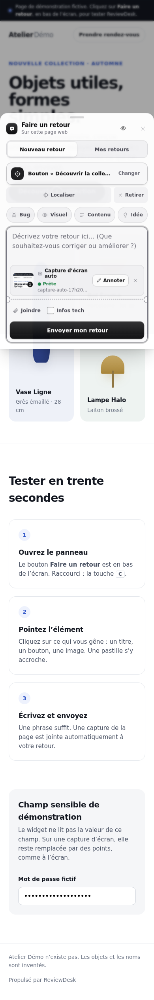
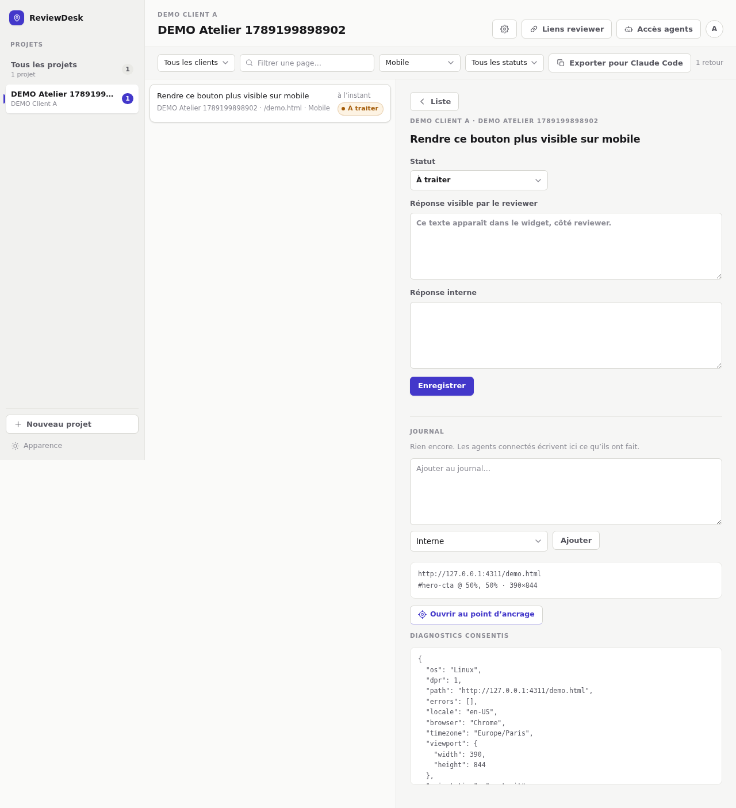

<div align="center">

# ReviewDesk

**Le retour visuel de vos clients, épinglé au bon endroit de la page.**

Votre client ouvre la préproduction, clique l'élément qui cloche, écrit une
phrase. Vous recevez un ticket ancré à cet élément exact, avec le statut, la
capture et votre réponse — sans compte à créer pour lui, sans Slack, sans
capture d'écran annotée par mail.

[](CHANGELOG.md)
[](package.json)
[](#architecture)

</div>

| Côté client (widget) | Côté agence (administration) |
| --- | --- |
|  |  |

---

## Sommaire

- [Pourquoi](#pourquoi)
- [Fonctionnalités](#fonctionnalités)
- [Démarrage en local](#démarrage-en-local)
- [Intégrer le widget sur un site](#intégrer-le-widget-sur-un-site)
- [Le parcours du reviewer](#le-parcours-du-reviewer)
- [L'administration](#ladministration)
- [Brancher un agent IA (MCP)](#brancher-un-agent-ia-mcp)
- [Identité](#identité)
- [Architecture](#architecture)
- [Configuration](#configuration)
- [Déploiement sur Vercel](#déploiement-sur-vercel)
- [Sécurité et confidentialité](#sécurité-et-confidentialité)
- [Référence API](#référence-api)
- [Développer et vérifier](#développer-et-vérifier)
- [Versions](#versions)
- [Limites connues](#limites-connues)
- [Contribuer](#contribuer)
- [Licence](#licence)

## Pourquoi

Un retour client sur une maquette en ligne arrive presque toujours sous une
forme inexploitable : « le bouton en bas est moche », dans un mail, sans URL, sans
taille d'écran, avec une capture recadrée. Il faut ensuite deviner de quel bouton
il s'agit, sur quelle page, dans quel navigateur.

ReviewDesk enlève cette étape de devinette. Le retour est **ancré à un élément
du DOM** et rejouable : depuis l'administration, un lien rouvre la
préproduction avec l'épingle reposée exactement au même endroit.

Et côté client, il n'y a rien à installer, rien à comprendre : un bouton
« Faire un retour », deux étapes, et il peut relire les réponses de l'équipe
au même endroit.

## Fonctionnalités

**Pour le client qui relit**

- un bouton flottant, deux étapes numérotées : montrer l'endroit, dire ce qui ne va pas ;
- surbrillance en direct de l'élément visé, nommé en clair (« Bouton « Voir la collection » »),
  jamais un sélecteur CSS ;
- capture facultative, choisie au clic ou simplement collée (`Ctrl/⌘ + V`), avec vignette avant envoi ;
- diagnostics techniques **opt-in**, avec aperçu exact de ce qui part ;
- onglet « Mes retours » : statut de chaque retour et réponse de l'équipe, sans
  avoir à écrire quoi que ce soit ;
- interface « liquid glass » : surfaces translucides, arêtes spéculaires, ressorts
  à l'ouverture — avec repli opaque si le navigateur ne floute pas ou si le
  visiteur demande moins de transparence ;
- thème pris **sur la page hôte**, pas sur le système du reviewer : le widget
  s'habille comme le site sur lequel il est posé ;
- widget en Shadow DOM : aucun CSS du site hôte ne le déforme, et il ne déforme rien ;
- desktop, tactile, clavier (`Échap` ferme, `⌘/Ctrl + ↵` envoie), thème clair/sombre automatique.

**Pour l'équipe qui traite**

- projets multiples, avec libellé client et **liste exacte** des origines autorisées ;
- liens reviewer révocables, sans compte ni mot de passe pour le client ;
- filtres projet, client, page/site, format et statut ; pagination par curseur ;
- statuts persistants `À traiter`, `En cours`, `À valider`, `Traité` ;
- **deux réponses distinctes** par retour : une note interne jamais exposée, et
  une réponse que le reviewer relit dans son widget ;
- **retour au point d'ancrage** : un lien rouvre la préproduction, épingle reposée ;
- **export « un seul prompt »** : tous les retours `À traiter` du périmètre filtré,
  avec page, sélecteur, écran et ancrage, en un bloc Markdown à coller dans un
  agent de code ;
- **parcours de connexion d'un agent** en trois étapes, avec la configuration
  écrite pour l'outil choisi et la détection en direct de sa première requête ;
- **serveur MCP + API agent** : un agent IA lit les retours, les commente,
  change leur statut et publie la réponse au client, avec un jeton révocable,
  scopé à un projet et en lecture seule si besoin ;
- **journal par retour** : chaque commentaire, humain ou agent, horodaté et
  rattaché au changement de statut qui l'accompagne ;
- **notification sortante** par projet : un POST JSON à chaque nouveau retour ;
- **vue d'ensemble** : ce qui attend, ce qui a bougé sur 7/30/90 jours, la
  répartition par statut, le classement des projets et des pages, et le journal
  des derniers mouvements — humains et agents ;
- **typographie Geist**, auto-hébergée (52 Ko pour les deux graisses variables) :
  la CSP n'autorise aucun CDN de polices, et une police qui doit arriver d'un
  tiers est une police qui parfois n'arrive pas ;
- **interface monochrome** : barre de navigation, barre de configuration, rail
  projets ; aucune couleur décorative, le statut se lit à un disque qui se vide ;
- interface utilisable de 390 px à un 21:9 de 3440 px ;
- téléchargements privés servis seulement après authentification admin.

## Démarrage en local

Pour **auto-héberger la version 8.0.0 sans les sources**, utilisez la
distribution Docker Compose : [guide d'auto-hébergement Docker](docs/GUIDE-DOCKER-FR.md).
L'hôte n'a besoin que de Docker Compose, d'un shell et d'`openssl` (pas de
Node) ; l'archive contient l'application compilée, PostgreSQL 17 interne et
se branche sur un bucket S3 HTTPS privé ; l'accès distant passe par un reverse
proxy HTTPS. Génération et tests : [documentation de packaging](docs/PACKAGING.md#distribution-docker-compose).

> **Obsolète :** le [kit ZIP local](docs/KIT-LOCAL.md) (Node 22 + PGlite,
> `node install.mjs` puis `node start.mjs`) reste disponible mais n'est plus la
> voie recommandée ; préférez la distribution Docker.

Le statut **tous droits réservés** reste inchangé pour les deux distributions.

Prérequis : Node 22.x.

```bash
git clone https://github.com/hugoinformatique/reviewdesk.git
cd reviewdesk
npm install
npm run build

ADMIN_PASSWORD="une-phrase-secrete-longue" \
DATABASE_URL="pglite://.data/reviewdesk" \
STORAGE_DRIVER=filesystem \
npm start
```

L'administration est sur <http://127.0.0.1:4300>.

Pour exercer le widget depuis une **origine réellement distincte** (c'est le
seul moyen de valider le CORS et l'authentification par lien) :

```bash
python3 -m http.server 4311 --bind 127.0.0.1 --directory public
```

Dans l'administration : créer un projet autorisant `http://127.0.0.1:4311`,
générer un lien reviewer, puis ouvrir

```text
http://127.0.0.1:4311/demo.html#project=…&review=…&api=http%3A%2F%2F127.0.0.1%3A4300
```

Le token reste dans le fragment, est retiré de l'URL après initialisation, et
part ensuite par en-tête `Authorization` — jamais en query HTTP.

## Intégrer le widget sur un site

### Une ligne, à coller avant `</body>`

```html
<script src="https://reviewdesk.example/widget.js"
        data-api="https://reviewdesk.example"
        data-project="UUID_DU_PROJET"
        data-token="SECRET_DU_LIEN_REVIEWER"></script>
```

C'est tout : le widget s'initialise seul, y compris s'il est injecté par un CMS
ou un gestionnaire de balises. L'administration génère ce snippet, déjà rempli,
au moment où vous créez un lien reviewer.

### Options

| Attribut | `init()` | Défaut | Effet |
| --- | --- | --- | --- |
| `data-api` | `api` | origine du script | Origine de l'API ReviewDesk. |
| `data-project` | `projectId` | — | UUID du projet. **Requis.** |
| `data-token` | `token` | — | Secret du lien reviewer. **Requis.** |
| `data-label` | `label` | `Faire un retour` | Libellé du bouton flottant. |
| `data-position` | `position` | `bottom-right` | `bottom-right` ou `bottom-left`. |
| `data-accent` | `accent` | `#4338ca` | Couleur d'accent, pour coller à la charte du site. |

### Initialisation manuelle

Utile en React, Astro ou Next quand le token vient d'un état applicatif. À
appeler côté client, après le chargement du script :

```html
<script src="https://reviewdesk.example/widget.js"></script>
<script>
  ReviewDesk.init({
    api: 'https://reviewdesk.example',
    projectId: 'UUID_DU_PROJET',
    token: 'SECRET_DU_LIEN_REVIEWER',
    label: 'Faire un retour',
    position: 'bottom-right',
  })
</script>
```

Le widget refuse de s'initialiser deux fois sur la même page.

> [!IMPORTANT]
> N'incluez ce script **que sur une préproduction protégée**. Le token présent
> dans la page vaut droit de déposer un retour sur le projet : il est révocable
> à tout moment depuis l'administration, mais il n'est pas secret pour qui
> accède à la page.

## Le parcours du reviewer

1. **Montrer l'endroit.** Un clic sur « Cliquez ici, puis l'endroit sur la page »
   passe la page en mode pointage : l'élément survolé est encadré et nommé. Un
   clic le fige et pose l'épingle. `Échap` ou *Annuler* sort du mode à tout
   moment — lire les réponses ne doit jamais coûter un ticket bidon.
2. **Dire ce qui ne va pas.** Un texte libre (4 000 caractères), une capture
   facultative, et les diagnostics si le reviewer les accepte.
3. **Envoyer.** Confirmation immédiate, puis suivi dans « Mes retours » :
   statut et réponse de l'équipe, avec un compteur sur le bouton flottant dès
   qu'une réponse arrive.

Ce que le widget capte est exactement ce que le reviewer a désigné et écrit :
il n'y a ni capture automatique, ni lecture du DOM, ni session replay.

## L'administration

Un seul secret (`ADMIN_PASSWORD`) ouvre l'administration. On y crée les projets
et leurs origines, on génère et révoque les liens reviewer, on filtre et on
traite les retours.

### La vue d'ensemble

L'onglet **« Vue d'ensemble »**, dans la barre de navigation, répond à trois
questions dans cet ordre : ce qui attend, comment la file bouge, et où se trouve
le travail.

- cinq indicateurs : retours **à traiter** (avec l'âge du plus ancien), retours
  **ouverts** (dont ceux qui traînent depuis plus de 7 jours), **reçus** et
  **traités** sur la période, chacun comparé à la période précédente de même
  longueur, et le **délai moyen** entre le dépôt et le passage à « traité » ;
- un graphe d'activité jour par jour, reçus contre traités, en SVG écrit à la
  main — l'administration ne charge aucun script tiers, et sa CSP le refuserait ;
- la répartition par statut, le classement des projets (cliquer une ligne filtre
  tout le reste dessus), les pages les plus signalées, et le journal des
  derniers mouvements, agents compris.

La période se choisit entre 7, 30 et 90 jours ; le projet sélectionné dans le
rail de gauche restreint l'ensemble des chiffres.

### Exporter le reste à faire en un prompt

Le bouton **« Exporter pour Claude Code »**, dans la barre de filtres, rassemble
**tous les retours au statut `À traiter`** du périmètre courant — projet, client,
page et format filtrés sont respectés, le filtre de statut est ignoré — et en
fait un seul bloc Markdown : pour chaque retour, le projet, la page, le sélecteur
CSS de l'élément visé et le point cliqué en pourcentage, la taille d'écran, les
diagnostics consentis, le lien de rejeu de l'épingle, la capture le cas échéant
et la note interne s'il y en a une. L'ordre est chronologique, du plus ancien au
plus récent, et l'export s'arrête à 400 retours.

Un clic sur **Copier le prompt** le met dans le presse-papier : il se colle tel
quel dans Claude Code ou tout autre agent, sans réécriture. Le prompt ne contient
aucun secret — ni mot de passe admin, ni token reviewer. Les liens de capture,
eux, restent protégés : ils ne s'ouvrent qu'avec une session admin.

Le rejeu d'épingle suppose que le widget est déjà installé sur la page ouverte,
ce qui est le cas d'une préproduction équipée du snippet ci-dessus. Le lien de
rejeu ne contient **aucun secret** : c'est le snippet de la page qui porte le
token, et l'ancre voyage dans le fragment d'URL, que le navigateur n'envoie
jamais au serveur du client.

## Brancher un agent IA (MCP)

Un agent de code (Claude Code, Codex, Cursor, Claude Desktop, VS Code, ou tout
client MCP) peut lire les retours, les traiter et rendre compte — sans qu'on lui
recopie quoi que ce soit.

### 1. Créer un jeton

Administration → **Accès agents** → libellé, portée (un projet ou tous), droits
(lecture seule ou lecture/écriture) → **Générer un jeton**. Le secret `rda_…`
n'est affiché **qu'une fois**, avec la configuration MCP déjà remplie. Il est
révocable à tout moment, et ne donne accès ni à l'administration, ni aux
projets, ni aux liens reviewer.

### Déclarer le serveur MCP à la main

Le serveur MCP tourne depuis une copie de ce dépôt (`npm run build`, qui produit
`dist/mcp.js`). Pour Claude Code :

```bash
claude mcp add reviewdesk \
  --env REVIEWDESK_URL=https://reviewdesk.example \
  --env REVIEWDESK_TOKEN=rda_… \
  -- node /chemin/vers/reviewdesk/dist/mcp.js
```

Ou, dans un `.mcp.json` / `claude_desktop_config.json` :

```json
{
  "mcpServers": {
    "reviewdesk": {
      "command": "node",
      "args": ["/chemin/vers/reviewdesk/dist/mcp.js"],
      "env": {
        "REVIEWDESK_URL": "https://reviewdesk.example",
        "REVIEWDESK_TOKEN": "rda_…"
      }
    }
  }
}
```

### 3. Ce que l'agent peut faire

| Outil | Effet |
| --- | --- |
| `list_projects` | Les projets visibles par le jeton, et le reste à faire par statut. |
| `list_tickets` | Les retours, filtrés par statut, projet, page ou format. |
| `get_ticket` | Le détail : élément visé, page, écran, diagnostics, journal. |
| `get_screenshot` | La capture jointe par le client, comme image. |
| `comment_ticket` | Un commentaire, interne ou **publié au client**. |
| `update_ticket` | Le statut **et** le compte rendu, en un seul appel. |

Une boucle typique : « regarde les retours à traiter du projet X, corrige-les,
et passe chaque ticket à `À valider` en expliquant ce que tu as changé ». Un
commentaire en `visibility: "reviewer"` devient la réponse que le client lit
dans son widget ; sinon il reste dans le journal, côté équipe.

Le journal de chaque retour est visible dans l'administration, sous la réponse :
les entrées d'un agent y sont distinguées de celles de l'équipe.

### Sans MCP

L'API agent est une API HTTP ordinaire, utilisable depuis n'importe quel script :

```bash
curl -H "Authorization: Bearer rda_…" \
  "https://reviewdesk.example/api/agent/tickets?status=TODO"

curl -X PATCH -H "Authorization: Bearer rda_…" -H "Content-Type: application/json" \
  -d '{"status":"DONE","comment":"Contraste corrigé.","visibility":"reviewer"}' \
  "https://reviewdesk.example/api/agent/tickets/UUID"
```

Elle s'authentifie par en-tête uniquement : pas de cookie, donc pas de surface
CSRF, et aucune origine n'est autorisée en CORS — un navigateur tiers ne peut pas
l'appeler à la place de l'agent.

## Identité

**La marque.** Une bulle de dialogue dont le seul contenu visible est le point
dont on parle : le retour, et l'endroit exact auquel il appartient. Un seul
tracé, une seule silhouette, lisible de 16 px à une tuile d'application. Elle
vit dans `public/favicon.svg`, dans le symbole `#i-brand` de l'administration et
dans le lanceur du widget — trois fichiers, un même chemin.

**Le logotype.** `Review` en graisse normale, `Desk` en demi-gras : le contraste
de graisse porte l'accent, ce qui laisse le symbole rester une forme pleine sans
que les deux se disputent l'attention.

**La typographie.** Geist et Geist Mono, auto-hébergées (SIL OFL 1.1). Chiffres
tabulaires partout, interlettrage qui se resserre à mesure que le corps grandit.

**La couleur.** Il n'y en a pas. Une rampe de gris, du blanc au noir, et le
noir comme couleur d'action — un bouton principal est de l'encre, et s'inverse
en thème sombre. Deux exceptions, chacune justifiée : le rouge des erreurs et
des actions destructrices, et les logos des outils dans le parcours de
connexion — un logo redessiné en gris cesse d'être le logo de cette marque.

**Le widget fait exception, exprès.** Côté client, il prend les couleurs de la
page qui l'accueille : ce n'est pas notre outil qui se montre, c'est le site du
client qui reçoit un commentaire. Seule la marque reste la nôtre.

**Tout ce qui précède est un défaut, pas une contrainte.** Une instance est
auto-hébergée et destinée à être revendue : l'assistant de personnalisation
(première connexion, puis l'entrée « Personnalisation ») remplace le nom, le
logo, le favicon et la couleur par ceux de l'agence qui la déploie. La rampe de
gris reste ce que voit une instance non configurée ; dès qu'une teinte est
choisie, elle devient la couleur d'action, et le texte qui s'y pose est calculé
pour rester lisible (`src/brand-tokens.ts`).

Les logos des outils tiers proviennent de [svgl.app](https://svgl.app) et
appartiennent à leurs propriétaires respectifs ; ils sont employés ici pour
désigner l'outil que la configuration vise, rien d'autre.

## Architecture

```text
public/widget.js   widget Shadow DOM (build de src/widget/index.ts)
public/admin.js    interface d'administration (build de src/admin/app.ts)
public/fonts/      Geist et Geist Mono (SIL OFL 1.1), auto-hébergés
public/favicon.svg marque du produit
src/app.ts         routes Fastify, validation Zod, garde d'origine et CSRF
src/mcp/server.ts  serveur MCP stdio (build de dist/mcp.js), adaptateur de l'API agent
src/db/            PostgreSQL (prod) ou PGlite (dev), migrations idempotentes
src/storage/       S3-compatible, Supabase Storage ou fichiers locaux (dev)
api/index.ts       handler serverless (Vercel)
```

Deux modes existent et ne se mélangent pas :

- **production** : PostgreSQL externe via `DATABASE_URL`, stockage objet
  S3-compatible **privé** via `STORAGE_DRIVER=s3` ;
- **développement local uniquement** : PGlite sur disque et fichiers locaux. Ces
  pilotes sont refusés si `NODE_ENV=production` ou `VERCEL=1`.

Chaque instance chaude réutilise un pool PostgreSQL borné
(`DATABASE_POOL_MAX=1` par défaut). Les migrations sont idempotentes,
sérialisées par advisory lock, et lançables au démarrage ou via `npm run migrate`.

## Configuration

Toutes les variables et leurs valeurs locales sont commentées dans
[`.env.example`](.env.example). Les principales :

| Variable | Défaut | Rôle |
| --- | --- | --- |
| `ADMIN_PASSWORD` | — | **Requis.** ≥ 16 caractères. Seule identité humaine. |
| `DATABASE_URL` | — | **Requis.** `postgresql://…` (prod, chaîne poolée) ou `pglite://…` (dev). |
| `DATABASE_POOL_MAX` | `1` | Connexions par instance. À ne monter que derrière un pooler. |
| `RUN_MIGRATIONS_ON_BOOT` | `true` | Mettre à `false` et migrer au build pour éviter le cold start. |
| `STORAGE_DRIVER` | — | `s3`, `supabase` ou `filesystem` (dev seulement). |
| `S3_ENDPOINT` / `S3_BUCKET` / `S3_REGION` | — | Bucket **privé** dédié. |
| `S3_ACCESS_KEY_ID` / `S3_SECRET_ACCESS_KEY` | — | Identifiants limités à ce bucket. |
| `UPLOAD_MAX_BYTES` | `4000000` | Sous la limite de 4,5 Mo d'un corps de requête Vercel. |
| `SUBMISSIONS_PER_MINUTE` | `20` | Limite persistante par lien reviewer. |
| `AGENT_REQUESTS_PER_MINUTE` | `120` | Limite persistante par jeton agent. |
| `SESSION_TTL_SECONDS` | `28800` | Durée de la session admin. |
| `WEBHOOK_TIMEOUT_MS` | `3000` | Budget de la notification sortante, attendue avant la réponse. |
| `LOG_LEVEL` | `warn` | Journalisation, secrets expurgés. |

## Déploiement sur Vercel

**1. PostgreSQL externe.** Une base **dédiée** (Neon, Supabase ou compatible),
avec sa chaîne **poolée** et TLS. Ne jamais réutiliser une base métier.

```text
DATABASE_URL=postgresql://...pooler.../reviewdesk?sslmode=require
DATABASE_POOL_MAX=1
```

**2. Stockage objet privé.** Un bucket dédié Cloudflare R2, AWS S3, Scaleway,
Backblaze B2 ou compatible. Pour R2 : bucket privé, ni `r2.dev` ni domaine
public, identifiants limités à ce bucket.

```text
STORAGE_DRIVER=s3
S3_ENDPOINT=https://<ACCOUNT_ID>.r2.cloudflarestorage.com
S3_BUCKET=reviewdesk-uploads
S3_REGION=auto
S3_ACCESS_KEY_ID=...
S3_SECRET_ACCESS_KEY=...
S3_FORCE_PATH_STYLE=true
```

**3. Variables et build.**

```text
ADMIN_PASSWORD=<phrase aléatoire longue>
NODE_ENV=production
RUN_MIGRATIONS_ON_BOOT=true
```

Importer le dépôt dans Vercel : `vercel.json` construit les assets statiques et
route `/api/*` et `/health` vers la fonction. Après déploiement : vérifier
`/health`, se connecter à l'administration, créer un projet et son origine,
tester un upload puis sa lecture admin.

Pour éviter les migrations au cold start : `RUN_MIGRATIONS_ON_BOOT=false` et
`npm run migrate` depuis un environnement disposant de `DATABASE_URL` avant le
déploiement.

Les coûts de base, de stockage, d'opérations et de sortie réseau sont ceux des
fournisseurs choisis ; ce dépôt ne provisionne aucune ressource.

## Sécurité et confidentialité

**Ce que le widget ne collecte jamais** : champs de formulaire, cookies,
`localStorage`, corps de requête réseau, texte du DOM, console arbitraire, IP
applicative, session replay.

**Diagnostics.** Désactivés par défaut. Après consentement, le reviewer voit
exactement les champs envoyés : viewport, DPR borné, orientation, locale,
fuseau, navigateur/OS grossiers, URL sans query ni hash ni credentials, et
erreurs structurées allowlistées.

**Libellé d'élément.** Le nom lisible affiché pendant le pointage (« Bouton
« … » ») est construit et affiché **localement**. Seuls le sélecteur et le point
relatif partent au serveur : aucun texte de la page ne se retrouve dans le
ticket au-delà de ce que le reviewer écrit lui-même.

**Authentification.** Les API reviewer exigent un bearer lié au projet **et**
une origine exacte ; CORS ne sert jamais d'authentification. Le secret du lien
n'est stocké que sous forme de SHA-256. Les mutations admin exigent un cookie
`HttpOnly`/`SameSite=Strict` et un jeton CSRF.

**Jetons agents.** Un secret machine `rda_…`, stocké en SHA-256 uniquement,
révocable, limité à un projet ou à tous, et en lecture seule si on le souhaite —
une tentative d'écriture renvoie alors `403 READ_ONLY_TOKEN`. Il n'ouvre ni
l'administration, ni la création de projets, ni les liens reviewer. L'API agent
s'authentifie par en-tête seul : aucun cookie, donc pas de CSRF, et aucune
origine n'est renvoyée en CORS. La limite est de 120 requêtes par minute et par
jeton, persistée comme les autres.

**Uploads.** Limités à 4 000 000 octets par défaut, vérifiés par signature de
fichier, SVG refusé, objets non publics. Les réponses privées portent
`no-store` et la journalisation expurge les secrets.

**Captures.** Exclusivement manuelles. ReviewDesk ne prétend pas masquer
automatiquement des données sensibles visibles dans une capture : le reviewer
contrôle le fichier avant l'envoi.

## Référence API

Reviewer — bearer du lien + origine autorisée :

| Méthode | Route | Effet |
| --- | --- | --- |
| `POST` | `/api/feedback?projectId=…` | Dépose un retour ancré. |
| `GET` | `/api/feedback?projectId=…` | Liste les retours de ce lien et leurs réponses. |
| `POST` | `/api/uploads?projectId=…` | Envoie une capture (`multipart/form-data`). |

Administration — cookie de session + jeton CSRF sur les mutations :

| Méthode | Route | Effet |
| --- | --- | --- |
| `POST` | `/api/auth/login` · `/api/auth/logout` | Session admin. |
| `GET` | `/api/auth/session` | État de session et jeton CSRF. |
| `GET` `POST` | `/api/projects` | Liste et création de projets. |
| `PATCH` | `/api/projects/:id` | Nom, client, origines, webhook. |
| `GET` `POST` | `/api/projects/:id/review-links` | Liens reviewer (le secret n'est montré qu'une fois). |
| `POST` | `/api/projects/:projectId/review-links/:linkId/revoke` | Révocation. |
| `GET` | `/api/tickets` | Triage filtré, pagination par curseur. |
| `GET` | `/api/stats` | Vue d'ensemble : `days` (7, 30, 90) et `projectId` optionnel. |
| `GET` | `/api/onboarding` | État d'installation, déduit des données. |
| `PATCH` | `/api/tickets/:id` | Statut, note interne, réponse au reviewer. |
| `GET` `POST` | `/api/tickets/:id/comments` | Journal d'un retour. |
| `GET` | `/api/uploads/:id` | Téléchargement privé d'une capture. |
| `GET` `POST` | `/api/agent-tokens` | Jetons agents (le secret n'est montré qu'une fois). |
| `POST` | `/api/agent-tokens/:id/revoke` | Révocation d'un jeton agent. |
| `GET` | `/health` | Sonde de disponibilité, sans métadonnée d'infrastructure. |

Agent — `Authorization: Bearer rda_…`, sans cookie ni CSRF :

| Méthode | Route | Effet |
| --- | --- | --- |
| `GET` | `/api/agent/context` | Portée du jeton et projets visibles, avec le compte par statut. |
| `GET` | `/api/agent/tickets` | Retours filtrés (`status`, `projectId`, `page`, `format`, `limit`, `cursor`). |
| `GET` | `/api/agent/tickets/:id` | Détail d'un retour et son journal. |
| `POST` | `/api/agent/tickets/:id/comments` | Commentaire interne ou publié au client. |
| `PATCH` | `/api/agent/tickets/:id` | Statut et commentaire, en un appel. |
| `GET` | `/api/agent/uploads/:id` | Capture d'un retour du projet du jeton. |

## Développer et vérifier

```bash
npm run dev          # serveur en rechargement à chaud
npm run build        # widget + admin + serveur
npm run lint         # ESLint
npm run typecheck    # tsc --noEmit
npm test             # tests unitaires et d'intégration
npm run test:docker  # idem, contre PostgreSQL + MinIO jetables
npm run test:e2e     # E2E Playwright, admin :4310 et preview :4311
npm run check        # tout l'enchaînement ci-dessus + npm audit --omit=dev
```

`npm run check` est la porte d'entrée : lint, typecheck, **75 tests Node**
(unitaires et intégration adversariale contre PostgreSQL + MinIO Docker
jetables — 3 d'entre eux sont sautés sans Docker), build, **3 E2E Playwright**
sur une origine réellement distincte, puis `npm audit --omit=dev`.

Le serveur MCP est testé comme un agent l'utilise : un vrai processus fils, du
vrai JSON-RPC sur stdio, contre une instance ReviewDesk qui écoute (voir
`tests/integration/mcp.test.ts`).

Le widget est un artefact de build : modifier `src/widget/index.ts`, jamais
`public/widget.js`, puis `npm run build:widget`.

## Versions

Les évolutions sont consignées dans [CHANGELOG.md](CHANGELOG.md), au format
Keep a Changelog. Version courante : **8.0.0**.

Le numéro se décide à la taille du changement : **majeur** pour une grosse
fonctionnalité ou une refonte, **mineur** pour une petite amélioration,
**correctif** pour un bug. Les ruptures sont signalées explicitement dans le
changelog.

## Limites connues

- une seule identité admin par secret d'environnement ; ni SSO ni comptes multiples ;
- aucune capture automatique, aucune annotation flèche/rectangle : upload manuel seulement ;
- rate limiting persistant par lien, mais pas de protection réseau/WAF distribuée ;
- le rejeu d'épingle échoue proprement (épingle rouge) si l'élément d'origine a
  disparu de la page ;
- aucune ressource PostgreSQL, bucket, projet Vercel ou domaine n'est provisionné ici ;
- une mise en ligne publique suppose au préalable la base dédiée, le bucket
  privé, les secrets, et une protection d'accès forte sur la préproduction.

## Contribuer

Les contributions sont bienvenues.

1. Ouvrir une issue décrivant le problème ou l'intention avant un gros changement.
2. Travailler sur une branche (`feat/…`, `fix/…`, `docs/…`).
3. `npm run check` doit passer en entier.
4. Ajouter une entrée sous `## [Non publié]` dans [CHANGELOG.md](CHANGELOG.md).
5. Les commentaires du code expliquent **pourquoi**, pas quoi : c'est la
   convention du dépôt, merci de la suivre.

Toute modification touchant la confidentialité (diagnostics, contenu envoyé,
journalisation) doit être accompagnée du test qui la verrouille.

## Licence

Ce dépôt n'est pas encore placé sous une licence open source : tous droits
réservés pour l'instant. Une licence permissive est envisagée ; d'ici là,
demandez avant toute réutilisation.
